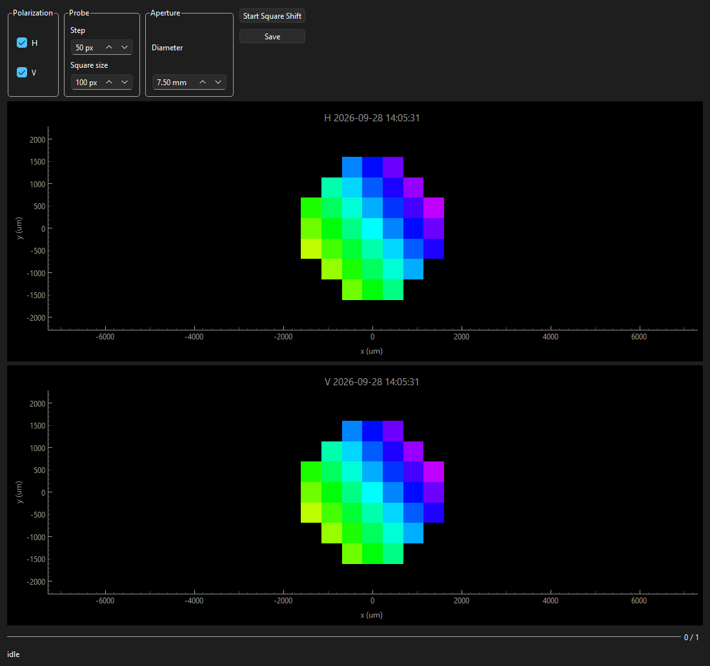

# SquareShiftingInterferometry

ModeLab square phase-shifting interferometry on the SLM. The SLM and power meter are passed in. This package does not open hardware and does not change the Zernike coefficients.

## Package layout

```
SquareShiftingInterferometry/
├── engine.py            SquareShifting scan thread and save
├── grid.py              aperture centers and the five-step piston
├── ui/                  PySide6 panel and pyqtgraph maps
├── scripts/release.py   git-tag release automation
├── pyproject.toml       package metadata + version
└── CHANGELOG.md
```

## Canonical imports

```python
from SquareShiftingInterferometry import SquareShifting
from SquareShiftingInterferometry.ui import SquareShiftingWidget  # requires the gui extra
```

## Quick start

```python
shifting = SquareShifting(slm, powermeter, slm_gui, zernike_gui, powermeter_gui)
shifting.set_saving_path(r"C:\path\to\parent")
shifting_gui = SquareShiftingWidget(shifting)
shifting_gui.show()
```

Without the three panels, the same scan still runs:

```python
shifting = SquareShifting(slm, powermeter)
shifting.scan("H")
# shifting.stop()
folder = shifting.save()
```

`scan` walks the downsampled centers inside the aperture, applies five piston steps in a square, and writes the complex sample into the coarse field for H, V, or both. `save` creates `square_shift_{timestamp}/` with `scan.json`, `{pol}_field.npz`, and `{pol}_field.png`.

## GUI

`SquareShiftingWidget` takes only the engine. The engine locks the SLM, Zernike, and power-meter panels when they were passed to it.

<!-- gui-screenshot -->

<!-- /gui-screenshot -->

## Installation

### From GitHub (tagged release)

```bash
pip install "SquareShiftingInterferometry[gui] @ git+https://github.com/MarKo7s/SquareShiftingInterferometry.git@v1.0.0"
```

That install also pulls `visualization` v1.0.0.

### Local development (editable install)

```bash
pip install -e ".[gui,notebooks]"
```

### Conda environment

Conda provides **Python + pip only**. Install numpy and PySide6 with **pip** so conda Qt DLLs do not conflict with PySide6 on Windows.

```bash
conda create -n squareshifting python=3.11 pip -y
conda activate squareshifting
pip install -e ".[gui,notebooks]"
```

## Developer notes

### Versioning

The package version is defined in **one place only**: `pyproject.toml` → `[project].version`.

Do **not** edit `__init__.py` on each release. `SquareShiftingInterferometry.__version__` is read from pip metadata after install.

Use [semantic versioning](https://semver.org/): `MAJOR.MINOR.PATCH`.

### Releasing a new version

1. Add `## [X.Y.Z]` at the top of `CHANGELOG.md`.
2. Set `version = "X.Y.Z"` in `pyproject.toml`.
3. Commit.
4. `python scripts/release.py --from-changelog`
